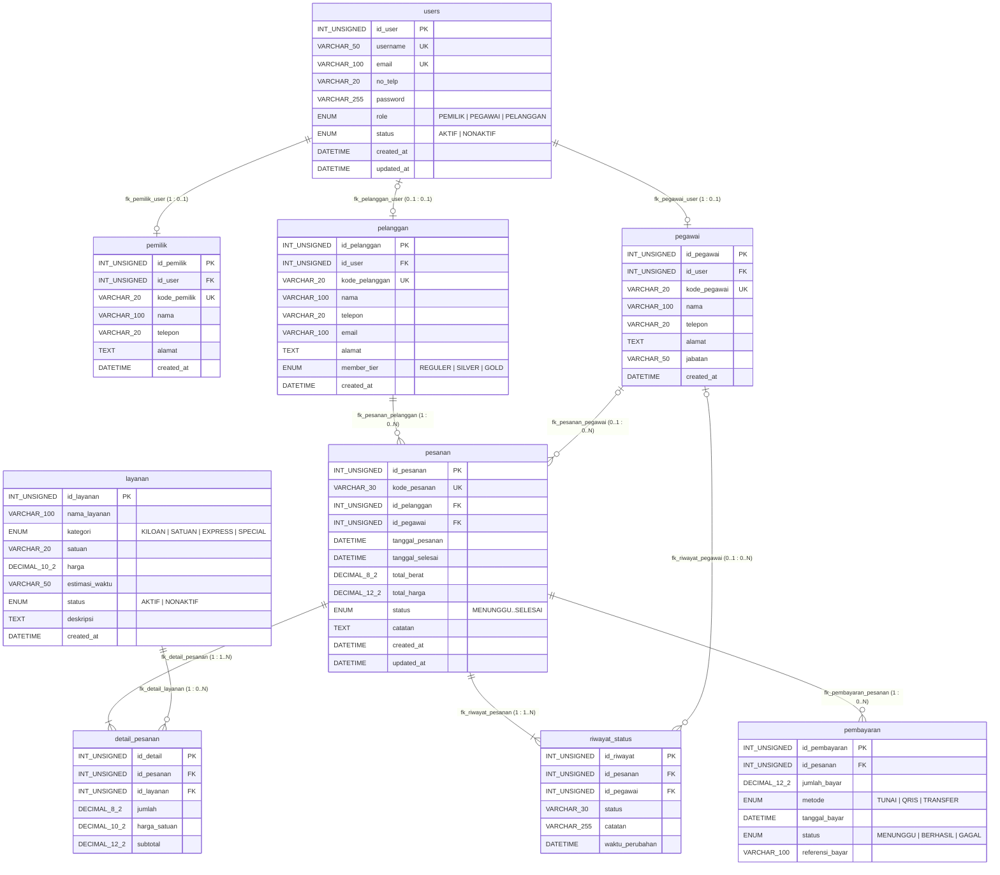

# Sistem Basis Data Laundry — BersihIn Laundry

# Sistem Basis Data Laundry

## 1. Deskripsi Proyek

**BersihIn Laundry** adalah sistem informasi dan basis data manajemen usaha laundry berbasis web (*Full-Stack Web Application*) yang terintegrasi dengan basis data relasional **MySQL (`bersihinlaundry`)**. Sistem ini dirancang dan dibangun untuk mendigitalisasi seluruh proses bisnis operasional laundry secara *end-to-end*, mulai dari pendaftaran dan autentikasi multi-peran (**Pelanggan**, **Pegawai/Staf**, dan **Pemilik/Owner**), pemesanan layanan laundry, perhitungan berat dan tarif otomatis, verifikasi pembayaran (**Tunai**, **QRIS**, **Transfer Bank**), pelacakan tahapan pengerjaan cucian secara *real-time* (*5-Step Progress Tracking*), pencatatan *audit trail* riwayat status, hingga pelaporan analitik pendapatan bisnis bagi pemilik usaha.

---

## 2. Anggota Kelompok (Kelompok Imut)

1. **Nazwa Aulia Hanifa** — `4525210053`
2. **Nevilla Ghilar Apryanti** — `4525210054`
3. **Nuristya Putri Agustina** — `4525210055`
4. **Ratu Annisaa Nabila Meysun** — `4525210063`
5. **Tazkia Putri Arsyad** — `4525210073`
6. **Septia Fitri Rahmadhani** — `4525210097`

---

## 3. Link Pengumpulan Tugas

Semua file dan hasil pengerjaan tugas Sistem Basis Data Laundry dapat diakses melalui link Google Drive berikut:

- **Folder Google Drive:** [Klik di sini untuk melihat semua file tugas](https://drive.google.com/drive/folders/1P9mAvXEskiaN0fCUKwG26f0a9xHlJnWL?usp=sharing)

---

## 4. Product Requirements Document (PRD)

### 4.1 Latar Belakang & Permasalahan

Usaha laundry modern mengelola volume data harian yang tinggi, mencakup identitas pelanggan, penugasan staf operasional, variasi paket layanan (kiloan, satuan, ekspres, maupun perawatan khusus), transaksi pesanan masuk, verifikasi pembayaran digital/tunai, hingga pemantauan tahapan cucian dari pakaian diterima sampai selesai diambil.

Apabila pencatatan masih dilakukan secara manual atau tidak terintegrasi dalam sistem basis data relasional yang terstruktur:
1. **Data Terfragmentasi & Rawan Hilang:** Nota kertas mudah terselip, menyebabkan kesulitan saat menelusuri riwayat pesanan atau status pembayaran pelanggan.
2. **Kurangnya Transparansi Status Cucian:** Pelanggan tidak dapat memantau apakah pakaian mereka sedang menunggu konfirmasi, diproses, dicuci, disetrika, atau sudah siap diambil.
3. **Risiko Kesalahan Perhitungan & Pembukuan:** Perhitungan berat cucian, tarif layanan, dan rekapitulasi omzet harian/bulanan rentan mengalami selisih (*human error*).
4. **Tidak Adanya Jejak Audit (*Audit Trail*):** Pemilik usaha sulit memantau pegawai mana yang menerima pesanan, memperbarui status cucian, atau memverifikasi pembayaran kasir.

Oleh karena itu, dibangunlah **Sistem Basis Data BersihIn Laundry** dengan skema relasional **9 tabel MySQL (InnoDB)** yang terhubung ke antarmuka portal **Pelanggan**, **Pegawai (Staff Portal)**, dan **Pemilik (Owner Console)** melalui **RESTful API Node.js + Express**.

---

### 4.2 Tujuan Sistem

Tujuan utama dari perancangan dan implementasi sistem basis data **BersihIn Laundry** adalah:
- Menyediakan penyimpanan data relasional yang terstruktur, ternormalisasi, dan bebas redundansi untuk seluruh entitas bisnis laundry (`users`, `pemilik`, `pegawai`, `pelanggan`, `layanan`, `pesanan`, `detail_pesanan`, `riwayat_status`, dan `pembayaran`).
- Memfasilitasi **Pelanggan** dalam melihat katalog layanan, membuat pesanan baru, memilih metode pembayaran, mengunduh/mencetak invoice, serta melacak progres cucian secara *real-time*.
- Memfasilitasi **Pegawai / Kasir** dalam mengelola data pelanggan, memverifikasi pembayaran tagihan invoice, memperbarui tahapan pengerjaan cucian (*5-Step Pipeline*), serta mengekspor laporan operasional ke format CSV.
- Memfasilitasi **Pemilik Usaha (Owner)** dalam mengelola akun pegawai, mengatur katalog paket & harga layanan, mengaudit invoice dan pembukuan transaksi, serta memantau laporan keuangan harian, bulanan, dan tahunan.

---

### 4.3 Pengguna Sistem & Hak Akses (*Role-Based Access Control*)

Sistem menerapkan pembagian hak akses berbasis peran (*Role-Based Access Control* / RBAC) untuk 3 aktor utama:

| Aktor / Peran | Portal Antarmuka | Tanggung Jawab & Hak Akses Utama |
| :--- | :--- | :--- |
| **1. Pelanggan** (`PELANGGAN`) | `PELANGGAN/*.html` | • Melihat ringkasan pesanan aktif & riwayat belanja di Dashboard Pelanggan.<br>• Melihat katalog paket layanan laundry beserta harga dan estimasi durasi.<br>• Membuat pesanan laundry baru, menghitung estimasi biaya, dan memilih metode bayar.<br>• Melacak status pengerjaan cucian secara *real-time* beserta log waktu perubahan.<br>• Melihat dan mencetak dokumen Invoice resmi serta memperbarui profil & password. |
| **2. Pegawai Laundry** (`PEGAWAI`) | `PEGAWAI/*.html` | • Memantau metrik operasional harian dan antrean pesanan pada Staff Portal.<br>• Mengelola dan mencari data pelanggan terdaftar serta mengekspor data ke CSV.<br>• Memeriksa detail pesanan, mencetak nota kasir, dan memverifikasi pembayaran (`LUNAS` / `Tolak`).<br>• Memperbarui tahapan pengerjaan laundry (`MENUNGGU` → `DIPROSES` → `DICUCI` → `DISETRIKA` → `SIAP_DIAMBIL` → `SELESAI`) yang tercatat otomatis ke tabel `riwayat_status`.<br>• Mengelola profil kepegawaian dan mengubah kata sandi akun staf. |
| **3. Pemilik Usaha** (`PEMILIK`) | `PEMILIK/*.html` | • Memantau KPI bisnis, grafik pertumbuhan pendapatan, dan aktivitas terbaru di Owner Console.<br>• Mengelola data pegawai (tambah pegawai baru, edit jabatan/kontak, aktifkan/nonaktifkan akun).<br>• Mengelola data pelanggan (lihat statistik pesanan & total belanja pelanggan, tambah pelanggan baru).<br>• Mengelola katalog layanan laundry (tambah layanan baru, ubah harga/estimasi, nonaktifkan layanan).<br>• Mengaudit seluruh transaksi, memeriksa invoice pembukuan, dan mencetak laporan keuangan (Harian, Bulanan, Tahunan). |

---

### 4.4 Ruang Lingkup Sistem

Ruang lingkup fungsionalitas sistem mencakup 4 modul utama:
1. **Modul Autentikasi & Keamanan Terpusat (`/api/auth`):**
   - Login multi-peran menggunakan username, email, atau nomor telepon.
   - Registrasi akun pelanggan baru yang otomatis membuat entitas di tabel `users` dan `pelanggan`.
   - Enkripsi kata sandi dengan algoritma **Bcrypt**, autentikasi token **JWT (JSON Web Token)** & *Express Session*, serta fitur ubah/reset password.
2. **Modul Portal Pelanggan (`/api/pelanggan`):**
   - Dashboard pelanggan (`dashboard.html`), katalog layanan (`layanan.html`), pembuatan pesanan (`pesanan.html`), pelacakan status (`status.html`), riwayat transaksi (`riwayat.html`), detail transaksi (`dtltransaksi.html`), invoice (`invoice.html`), profil (`profil.html`, `editprofil.html`), dan keamanan (`password.html`).
3. **Modul Portal Pegawai / Staf Operasional (`/api/pegawai`):**
   - Dashboard staf (`dashboard.html`), manajemen pelanggan (`datapelanggan.html`, `detailpelanggan.html`), manajemen pesanan (`datapesanan.html`, `detailpesanan.html`), kelola status *5-step pipeline* (`statuspesanan.html`), manajemen transaksi & pembayaran (`datatransaksi.html`), pemeriksaan invoice kasir (`invoice.html`), serta profil staf (`profil.html`, `editprofil.html`, `password.html`).
4. **Modul Console Pemilik Usaha (`/api/pemilik`):**
   - Dashboard analitik pemilik (`dashboard.html`), manajemen pegawai (`datapegawai.html`, `tambahpegawai.html`), manajemen pelanggan (`datapelanggan.html`, `tambahpelanggan.html`), manajemen katalog layanan (`layananpegawai.html`, `tambahlayanan.html`, `editlayanan.html`), manajemen transaksi (`transaksi.html`), pemeriksaan invoice & pembukuan (`invoice.html`), laporan keuangan (`laporan.html`), serta profil pemilik (`profil.html`, `editprofil.html`, `password.html`).

---

### 4.5 Kebutuhan Fungsional (*Functional Requirements*)

#### A. Autentikasi & Manajemen Akun (`FR-AUTH`)
| Kode | Deskripsi Kebutuhan Fungsional |
| :---: | :--- |
| **FR-01** | Sistem harus menyediakan fitur registrasi akun pelanggan baru yang menyimpan kredensial ke tabel `users` dan profil ke tabel `pelanggan` dengan kode unik otomatis (`PLG-XXXXX`). |
| **FR-02** | Sistem harus memvalidasi login pengguna berdasarkan `username`, `email`, atau `no_telp` beserta verifikasi hash password Bcrypt dan mengarahkan pengguna ke dashboard sesuai perannya (`PEMILIK`, `PEGAWAI`, atau `PELANGGAN`). |
| **FR-03** | Sistem harus memungkinkan seluruh aktor untuk memperbarui kata sandi akun (`PUT /api/auth/password`) setelah memverifikasi password lama dan mengevaluasi kekuatan password baru. |
| **FR-04** | Sistem harus mendukung proses keluar sesi (*logout*) yang menghapus token JWT di sisi klien dan menghancurkan sesi aktif di sisi server. |

#### B. Modul Pelanggan (`FR-CUST`)
| Kode | Deskripsi Kebutuhan Fungsional |
| :---: | :--- |
| **FR-05** | Sistem harus menampilkan daftar paket layanan laundry yang berstatus `AKTIF` beserta kategori, harga per satuan (`kg`/`pcs`/`pasang`), dan estimasi waktu pengerjaan. |
| **FR-06** | Sistem harus memungkinkan pelanggan membuat pesanan baru (`POST /api/pelanggan/pesanan`) dengan memilih layanan, memasukkan estimasi berat/jumlah, catatan khusus, dan metode pembayaran (`TUNAI`, `QRIS`, `TRANSFER`). |
| **FR-07** | Sistem harus menyimpan pesanan baru beserta rincian item layanan (`detail_pesanan`), status awal `MENUNGGU` pada `riwayat_status`, dan tagihan pada tabel `pembayaran` dalam satu transaksi database atomik. |
| **FR-08** | Sistem harus memungkinkan pelanggan melacak tahapan pengerjaan cucian secara *real-time* berdasarkan nomor pesanan (`TRX-...`) beserta riwayat waktu perubahan statusnya. |
| **FR-09** | Sistem harus menyediakan halaman riwayat pesanan, rincian transaksi, serta dokumen invoice resmi yang dapat dicetak atau diunduh oleh pelanggan. |
| **FR-10** | Sistem harus memungkinkan pelanggan melihat dan memperbarui informasi profil pribadi (nama lengkap, nomor telepon/WhatsApp, email, dan alamat penjemputan/pengantaran). |

#### C. Modul Pegawai / Staf Operasional (`FR-STAFF`)
| Kode | Deskripsi Kebutuhan Fungsional |
| :---: | :--- |
| **FR-11** | Sistem harus menampilkan ringkasan metrik operasional pada Dashboard Pegawai (total pelanggan, total pesanan, pesanan menunggu konfirmasi, dan pesanan selesai). |
| **FR-12** | Sistem harus memungkinkan pegawai mencari, memfilter, melihat detail profil & jumlah pesanan pelanggan, serta mengekspor daftar pelanggan ke file CSV. |
| **FR-13** | Sistem harus memungkinkan pegawai memeriksa daftar pesanan, melihat detail item cucian & catatan pelanggan, serta mencetak nota pesanan. |
| **FR-14** | Sistem harus memungkinkan pegawai memperbarui status pengerjaan pesanan (`PATCH /api/pegawai/pesanan/:id/status`) sesuai aturan transisi tahapan yang valid dan mencatat setiap perubahan beserta ID pegawai ke tabel `riwayat_status`. |
| **FR-15** | Sistem harus menyediakan fitur pemeriksaan invoice & konfirmasi pembayaran kasir (`POST /api/pegawai/pesanan/:id/konfirmasi-pembayaran`) yang memperbarui status pembayaran menjadi `BERHASIL` (`Lunas`) dan status pesanan menjadi `DIPROSES` secara atomik. |
| **FR-16** | Sistem harus memungkinkan pegawai menolak atau membatalkan pesanan yang tidak valid (`POST /api/pegawai/pesanan/:id/tolak`) dengan mencatat alasan pembatalan ke `riwayat_status`. |

#### D. Modul Pemilik Usaha / Owner (`FR-OWNER`)
| Kode | Deskripsi Kebutuhan Fungsional |
| :---: | :--- |
| **FR-17** | Sistem harus menampilkan ringkasan eksekutif pada Dashboard Pemilik, meliputi total pendapatan, total transaksi, jumlah pelanggan, pegawai aktif, grafik tren pendapatan, dan aktivitas pesanan terbaru dari MySQL. |
| **FR-18** | Sistem harus memungkinkan pemilik menambah pegawai baru (`POST /api/pemilik/pegawai`), memperbarui data jabatan/kontak pegawai (`PUT /api/pemilik/pegawai/:id`), serta mengaktifkan/menonaktifkan akun pegawai. |
| **FR-19** | Sistem harus memungkinkan pemilik melihat daftar pelanggan beserta agregasi `COUNT(id_pesanan)` dan `SUM(total_harga)` belanja, serta mendaftarkan pelanggan baru. |
| **FR-20** | Sistem harus memungkinkan pemilik mengelola katalog layanan laundry: menambah paket layanan baru (`POST /api/pemilik/layanan`), mengubah harga/deskripsi/durasi (`PUT /api/pemilik/layanan/:id`), dan mengubah status aktif/nonaktif layanan. |
| **FR-21** | Sistem harus menyediakan halaman manajemen transaksi dan pemeriksaan invoice bagi pemilik untuk mengaudit status pembayaran dan mencetak lembar pembukuan resmi. |
| **FR-22** | Sistem harus menyajikan laporan analitik keuangan berdasarkan filter rentang waktu (Harian, Bulanan, Tahunan) beserta rincian pendapatan per metode pembayaran dan fitur cetak/ekspor laporan. |

---

### 4.6 Kebutuhan Non-Fungsional (*Non-Functional Requirements*)

| Kode | Kategori | Spesifikasi Kebutuhan Non-Fungsional |
| :---: | :--- | :--- |
| **NFR-01** | **Integritas Basis Data (ACID)** | Operasi multi-tabel seperti pembuatan pesanan (`pesanan` + `detail_pesanan` + `riwayat_status` + `pembayaran`) dan konfirmasi pembayaran wajib menggunakan transaksi MySQL (`BEGIN`, `COMMIT`, `ROLLBACK`) dengan *row-level locking* (`FOR UPDATE`). |
| **NFR-02** | **Keamanan & Enkripsi** | Seluruh kata sandi pengguna wajib di-hash menggunakan `bcryptjs` (salt rounds = 10). Endpoint API yang bersifat privat wajib dilindungi oleh middleware verifikasi JWT Token dan pengecekan `role`. |
| **NFR-03** | **Integritas Referensial** | Seluruh relasi antar-tabel wajib ditegakkan di tingkat RDBMS InnoDB menggunakan *Foreign Key Constraints* (`ON DELETE CASCADE`, `ON DELETE RESTRICT`, atau `ON DELETE SET NULL` sesuai konteks bisnis). |
| **NFR-04** | **Sinkronisasi Real-Time** | Perubahan status cucian atau verifikasi pembayaran oleh pegawai harus langsung tersinkronisasi ke basis data MySQL dan memperbarui tampilan di portal Pelanggan maupun Pemilik secara *real-time*. |
| **NFR-05** | **Ketersediaan & Fallback** | Sistem memiliki mekanisme *graceful fallback* ke penyimpanan memori/lokal apabila koneksi layanan MySQL sedang tidak tersedia, sehingga antarmuka tidak mengalami kegagalan fatal (*crash*). |
| **NFR-06** | **Responsivitas Antarmuka** | Seluruh halaman pada portal Pelanggan, Pegawai, dan Pemilik dirancang responsif (*Mobile-First & Desktop-Ready*) menggunakan Tailwind CSS dan mendukung stylesheet cetak (`@media print`) untuk struk/invoice. |

---

### 4.7 Rancangan Basis Data Relasional (9 Tabel Entitas & Atribut)

Basis data **`bersihinlaundry`** dirancang menggunakan engine **InnoDB** (`utf8mb4_unicode_ci`) yang terdiri atas **9 tabel relasional**:

#### 1. Tabel `users` (Akun Autentikasi Terpusat)
| Nama Kolom | Tipe Data | Constraint / Key | Keterangan |
| :--- | :--- | :--- | :--- |
| `id_user` | `INT UNSIGNED` | **PRIMARY KEY**, `AUTO_INCREMENT` | ID unik akun pengguna |
| `username` | `VARCHAR(50)` | **UNIQUE**, `NOT NULL` | Username unik untuk login |
| `email` | `VARCHAR(100)` | **UNIQUE**, `DEFAULT NULL` | Alamat email pengguna |
| `no_telp` | `VARCHAR(20)` | `INDEX`, `DEFAULT NULL` | Nomor telepon pengguna |
| `password` | `VARCHAR(255)` | `NOT NULL` | Hash password Bcrypt |
| `role` | `ENUM('PEMILIK','PEGAWAI','PELANGGAN')` | `NOT NULL` | Peran hak akses aktor |
| `status` | `ENUM('AKTIF','NONAKTIF')` | `NOT NULL`, `DEFAULT 'AKTIF'` | Status keaktifan akun |
| `created_at` | `DATETIME` | `NOT NULL`, `DEFAULT CURRENT_TIMESTAMP` | Waktu pembuatan akun |
| `updated_at` | `DATETIME` | `NOT NULL`, `ON UPDATE CURRENT_TIMESTAMP` | Waktu pembaruan terakhir |

#### 2. Tabel `pemilik` (Profil Pemilik Bisnis / Super Admin)
| Nama Kolom | Tipe Data | Constraint / Key | Keterangan |
| :--- | :--- | :--- | :--- |
| `id_pemilik` | `INT UNSIGNED` | **PRIMARY KEY**, `AUTO_INCREMENT` | ID unik pemilik |
| `id_user` | `INT UNSIGNED` | **FOREIGN KEY** (`users.id_user`), `NOT NULL` | Referensi akun user (`ON DELETE CASCADE`) |
| `kode_pemilik` | `VARCHAR(20)` | **UNIQUE**, `NOT NULL` | Kode bisnis pemilik (contoh: `OWN-001`) |
| `nama` | `VARCHAR(100)` | `NOT NULL` | Nama lengkap pemilik usaha |
| `telepon` | `VARCHAR(20)` | `NOT NULL` | Nomor telepon aktif pemilik |
| `alamat` | `TEXT` | `DEFAULT NULL` | Alamat domisili/outlet pusat |
| `created_at` | `DATETIME` | `NOT NULL`, `DEFAULT CURRENT_TIMESTAMP` | Waktu pencatatan profil |

#### 3. Tabel `pegawai` (Data Diri & Jabatan Staf Operasional)
| Nama Kolom | Tipe Data | Constraint / Key | Keterangan |
| :--- | :--- | :--- | :--- |
| `id_pegawai` | `INT UNSIGNED` | **PRIMARY KEY**, `AUTO_INCREMENT` | ID unik pegawai |
| `id_user` | `INT UNSIGNED` | **FOREIGN KEY** (`users.id_user`), `NOT NULL` | Referensi akun user (`ON DELETE CASCADE`) |
| `kode_pegawai` | `VARCHAR(20)` | **UNIQUE**, `NOT NULL` | Kode identitas pegawai (contoh: `PGW-001`) |
| `nama` | `VARCHAR(100)` | `NOT NULL` | Nama lengkap pegawai |
| `telepon` | `VARCHAR(20)` | `NOT NULL` | Nomor HP / WhatsApp pegawai |
| `alamat` | `TEXT` | `DEFAULT NULL` | Alamat tempat tinggal pegawai |
| `jabatan` | `VARCHAR(50)` | `NOT NULL`, `DEFAULT 'Kasir'` | Posisi kerja (`Kasir Utama`, `Operator Cuci`, dll.) |
| `created_at` | `DATETIME` | `NOT NULL`, `DEFAULT CURRENT_TIMESTAMP` | Waktu bergabung pegawai |

#### 4. Tabel `pelanggan` (Profil & Keanggotaan Pelanggan Laundry)
| Nama Kolom | Tipe Data | Constraint / Key | Keterangan |
| :--- | :--- | :--- | :--- |
| `id_pelanggan` | `INT UNSIGNED` | **PRIMARY KEY**, `AUTO_INCREMENT` | ID unik pelanggan |
| `id_user` | `INT UNSIGNED` | **FOREIGN KEY** (`users.id_user`), `DEFAULT NULL` | Referensi akun login (`ON DELETE SET NULL`) |
| `kode_pelanggan` | `VARCHAR(20)` | **UNIQUE**, `NOT NULL` | Kode pelanggan (contoh: `PLG-08129`) |
| `nama` | `VARCHAR(100)` | `NOT NULL` | Nama lengkap pelanggan |
| `telepon` | `VARCHAR(20)` | `NOT NULL`, `INDEX` | Nomor HP / WhatsApp pelanggan |
| `email` | `VARCHAR(100)` | `DEFAULT NULL` | Alamat email pelanggan |
| `alamat` | `TEXT` | `DEFAULT NULL` | Alamat lengkap pelanggan |
| `member_tier` | `ENUM('REGULER','SILVER','GOLD')` | `NOT NULL`, `DEFAULT 'SILVER'` | Kategori loyalitas pelanggan |
| `created_at` | `DATETIME` | `NOT NULL`, `DEFAULT CURRENT_TIMESTAMP` | Tanggal bergabung pelanggan |

#### 5. Tabel `layanan` (Katalog Paket & Tarif Laundry)
| Nama Kolom | Tipe Data | Constraint / Key | Keterangan |
| :--- | :--- | :--- | :--- |
| `id_layanan` | `INT UNSIGNED` | **PRIMARY KEY**, `AUTO_INCREMENT` | ID unik layanan |
| `nama_layanan` | `VARCHAR(100)` | `NOT NULL` | Nama paket layanan laundry |
| `kategori` | `ENUM('KILOAN','SATUAN','EXPRESS','SPECIAL')` | `NOT NULL`, `DEFAULT 'KILOAN'` | Kategori jenis layanan |
| `satuan` | `VARCHAR(20)` | `NOT NULL`, `DEFAULT 'kg'` | Satuan hitung (`kg`, `pcs`, `pasang`, `meter`) |
| `harga` | `DECIMAL(10,2)` | `NOT NULL`, `DEFAULT 0.00` | Harga tarif dasar per satuan |
| `estimasi_waktu` | `VARCHAR(50)` | `DEFAULT '2 Hari'` | Estimasi durasi penyelesaian |
| `status` | `ENUM('AKTIF','NONAKTIF')` | `NOT NULL`, `DEFAULT 'AKTIF'` | Status ketersediaan layanan di katalog |
| `deskripsi` | `TEXT` | `DEFAULT NULL` | Penjelasan rincian layanan |
| `created_at` | `DATETIME` | `NOT NULL`, `DEFAULT CURRENT_TIMESTAMP` | Waktu penambahan layanan |

#### 6. Tabel `pesanan` (Transaksi Induk Cucian Laundry)
| Nama Kolom | Tipe Data | Constraint / Key | Keterangan |
| :--- | :--- | :--- | :--- |
| `id_pesanan` | `INT UNSIGNED` | **PRIMARY KEY**, `AUTO_INCREMENT` | ID unik transaksi pesanan |
| `kode_pesanan` | `VARCHAR(30)` | **UNIQUE**, `NOT NULL` | Nomor invoice/pesanan (contoh: `TRX-240518-01`) |
| `id_pelanggan` | `INT UNSIGNED` | **FOREIGN KEY** (`pelanggan.id_pelanggan`), `NOT NULL` | Pelanggan pemilik pesanan (`ON DELETE RESTRICT`) |
| `id_pegawai` | `INT UNSIGNED` | **FOREIGN KEY** (`pegawai.id_pegawai`), `DEFAULT NULL` | Pegawai penanggung jawab (`ON DELETE SET NULL`) |
| `tanggal_pesanan` | `DATETIME` | `NOT NULL`, `DEFAULT CURRENT_TIMESTAMP` | Tanggal & waktu pesanan masuk |
| `tanggal_selesai` | `DATETIME` | `DEFAULT NULL` | Tanggal & waktu pesanan selesai |
| `total_berat` | `DECIMAL(8,2)` | `DEFAULT NULL` | Total berat cucian dalam kilogram |
| `total_harga` | `DECIMAL(12,2)` | `NOT NULL`, `DEFAULT 0.00` | Akumulasi total biaya pesanan |
| `status` | `ENUM('MENUNGGU','DIPROSES','DICUCI','DISETRIKA','SIAP_DIAMBIL','SELESAI','DIBATALKAN')` | `NOT NULL`, `DEFAULT 'MENUNGGU'` | Tahapan pengerjaan cucian saat ini |
| `catatan` | `TEXT` | `DEFAULT NULL` | Instruksi/catatan khusus pelanggan |
| `created_at` | `DATETIME` | `NOT NULL`, `DEFAULT CURRENT_TIMESTAMP` | Waktu pembuatan record |
| `updated_at` | `DATETIME` | `NOT NULL`, `ON UPDATE CURRENT_TIMESTAMP` | Waktu pembaruan terakhir |

#### 7. Tabel `detail_pesanan` (Rincian Item Layanan per Pesanan)
| Nama Kolom | Tipe Data | Constraint / Key | Keterangan |
| :--- | :--- | :--- | :--- |
| `id_detail` | `INT UNSIGNED` | **PRIMARY KEY**, `AUTO_INCREMENT` | ID unik baris detail pesanan |
| `id_pesanan` | `INT UNSIGNED` | **FOREIGN KEY** (`pesanan.id_pesanan`), `NOT NULL` | Referensi pesanan induk (`ON DELETE CASCADE`) |
| `id_layanan` | `INT UNSIGNED` | **FOREIGN KEY** (`layanan.id_layanan`), `NOT NULL` | Referensi paket layanan (`ON DELETE RESTRICT`) |
| `jumlah` | `DECIMAL(8,2)` | `NOT NULL`, `DEFAULT 1.00` | Kuantitas / berat cucian untuk layanan tersebut |
| `harga_satuan` | `DECIMAL(10,2)` | `NOT NULL`, `DEFAULT 0.00` | Snapshot harga satuan saat transaksi dibuat |
| `subtotal` | `DECIMAL(12,2)` | `NOT NULL`, `DEFAULT 0.00` | Hasil perkalian `jumlah * harga_satuan` |

#### 8. Tabel `riwayat_status` (Log Audit Perubahan Tahapan Laundry)
| Nama Kolom | Tipe Data | Constraint / Key | Keterangan |
| :--- | :--- | :--- | :--- |
| `id_riwayat` | `INT UNSIGNED` | **PRIMARY KEY**, `AUTO_INCREMENT` | ID unik log riwayat status |
| `id_pesanan` | `INT UNSIGNED` | **FOREIGN KEY** (`pesanan.id_pesanan`), `NOT NULL` | Referensi pesanan (`ON DELETE CASCADE`) |
| `id_pegawai` | `INT UNSIGNED` | **FOREIGN KEY** (`pegawai.id_pegawai`), `DEFAULT NULL` | Pegawai yang mengubah status (`ON DELETE SET NULL`) |
| `status` | `VARCHAR(30)` | `NOT NULL` | Nama tahapan status yang diterapkan |
| `catatan` | `VARCHAR(255)` | `DEFAULT NULL` | Keterangan operasional perubahan status |
| `waktu_perubahan` | `DATETIME` | `NOT NULL`, `DEFAULT CURRENT_TIMESTAMP` | Timestamp perubahan tahapan |

#### 9. Tabel `pembayaran` (Transaksi Pembayaran Kasir / QRIS / Transfer)
| Nama Kolom | Tipe Data | Constraint / Key | Keterangan |
| :--- | :--- | :--- | :--- |
| `id_pembayaran` | `INT UNSIGNED` | **PRIMARY KEY**, `AUTO_INCREMENT` | ID unik transaksi pembayaran |
| `id_pesanan` | `INT UNSIGNED` | **FOREIGN KEY** (`pesanan.id_pesanan`), `NOT NULL` | Referensi pesanan yang dibayar (`ON DELETE CASCADE`) |
| `jumlah_bayar` | `DECIMAL(12,2)` | `NOT NULL`, `DEFAULT 0.00` | Nominal pembayaran dalam Rupiah |
| `metode` | `ENUM('TUNAI','QRIS','TRANSFER')` | `NOT NULL`, `DEFAULT 'TUNAI'` | Metode pembayaran yang dipilih |
| `tanggal_bayar` | `DATETIME` | `NOT NULL`, `DEFAULT CURRENT_TIMESTAMP` | Waktu pembayaran dicatat/diverifikasi |
| `status` | `ENUM('MENUNGGU','BERHASIL','GAGAL')` | `NOT NULL`, `DEFAULT 'MENUNGGU'` | Status verifikasi pembayaran |
| `referensi_bayar` | `VARCHAR(100)` | `DEFAULT NULL` | Kode referensi bukti QRIS / Transfer / Kasir |

---

### 4.8 Relationship, Kardinalitas, & Entity-Relationship Diagram (ERD)

| No | Nama Constraint | Entitas Induk (Parent) | Entitas Anak (Child) | Kardinalitas | Aturan `ON DELETE` | Penjelasan Relasi Bisnis |
| :-: | :--- | :--- | :--- | :---: | :---: | :--- |
| 1 | `fk_pemilik_user` | `users` | `pemilik` | `1 : 0..1` | `CASCADE` | Satu akun user dengan peran `PEMILIK` memiliki satu profil pemilik. |
| 2 | `fk_pegawai_user` | `users` | `pegawai` | `1 : 0..1` | `CASCADE` | Satu akun user dengan peran `PEGAWAI` memiliki satu profil kepegawaian. |
| 3 | `fk_pelanggan_user` | `users` | `pelanggan` | `0..1 : 0..1` | `SET NULL` | Pelanggan dapat memiliki akun login mandiri atau didaftarkan langsung di outlet. |
| 4 | `fk_pesanan_pelanggan` | `pelanggan` | `pesanan` | `1 : 0..N` | `RESTRICT` | Satu pelanggan dapat melakukan banyak transaksi pesanan laundry. |
| 5 | `fk_pesanan_pegawai` | `pegawai` | `pesanan` | `0..1 : 0..N` | `SET NULL` | Satu pegawai dapat menangani banyak pesanan laundry. |
| 6 | `fk_detail_pesanan` | `pesanan` | `detail_pesanan` | `1 : 1..N` | `CASCADE` | Satu pesanan memiliki satu atau lebih rincian item layanan. |
| 7 | `fk_detail_layanan` | `layanan` | `detail_pesanan` | `1 : 0..N` | `RESTRICT` | Satu paket layanan dapat digunakan pada banyak detail pesanan. |
| 8 | `fk_riwayat_pesanan` | `pesanan` | `riwayat_status` | `1 : 1..N` | `CASCADE` | Satu pesanan memiliki banyak catatan riwayat perubahan tahapan status. |
| 9 | `fk_riwayat_pegawai` | `pegawai` | `riwayat_status` | `0..1 : 0..N` | `SET NULL` | Satu pegawai dapat mencatat banyak riwayat perubahan status pesanan. |
| 10 | `fk_pembayaran_pesanan` | `pesanan` | `pembayaran` | `1 : 0..N` | `CASCADE` | Satu pesanan memiliki catatan transaksi pembayaran tagihan. |



---

### 4.9 Aturan Bisnis (*Business Rules*)

1. **Keunikan Kode Identitas:** Setiap entitas utama wajib memiliki kode bisnis unik yang terindeks (`UNIQUE`), yaitu `kode_pemilik` (`OWN-XXX`), `kode_pegawai` (`PGW-XXX`), `kode_pelanggan` (`PLG-XXXXX`), dan `kode_pesanan` (`TRX-XXXXXX-XX`).
2. **Isolasi Harga Historis (*Price Snapshot*):** Perubahan harga pada tabel `layanan` oleh Pemilik tidak boleh mengubah total tagihan pesanan lama; karena harga saat transaksi berlangsung disimpan secara permanen pada kolom `detail_pesanan.harga_satuan` dan `detail_pesanan.subtotal`.
3. **Perlindungan Data Transaksi (`ON DELETE RESTRICT`):** Data pelanggan atau paket layanan yang sudah memiliki riwayat transaksi di tabel `pesanan` / `detail_pesanan` tidak boleh dihapus secara fisik agar integritas laporan keuangan tetap terjaga. Untuk menonaktifkan layanan, digunakan kolom `status = 'NONAKTIF'`.
4. **Aturan Transisi Status Pesanan (*State Machine*):**
   - `MENUNGGU` → `DIPROSES` → `DICUCI` → `DISETRIKA` → `SIAP_DIAMBIL` → `SELESAI` (atau `DIBATALKAN`).
   - Saat status pesanan mencapai `SELESAI`, kolom `pesanan.tanggal_selesai` otomatis diisi dengan waktu saat ini (`CURRENT_TIMESTAMP`).
5. **Perhitungan Pendapatan Bersih:** Hanya pesanan yang tidak berstatus `DIBATALKAN` dan pembayaran yang berstatus `BERHASIL` yang dihitung sebagai pendapatan bersih pada laporan keuangan Pemilik.

---

### 4.10 Spesifikasi Endpoint REST API

| Modul | Method & Endpoint | Controller | Deskripsi Fungsi |
| :--- | :--- | :--- | :--- |
| **Auth** | `POST /api/auth/login` | `authController.login` | Autentikasi multi-peran & pembuatan JWT Token |
| **Auth** | `POST /api/auth/register` | `authController.register` | Registrasi pelanggan baru (`users` + `pelanggan`) |
| **Auth** | `PUT /api/auth/password` | `authController.updatePassword` | Verifikasi password lama & update hash Bcrypt baru |
| **Auth** | `POST /api/auth/logout` | `authController.logout` | Akhiri sesi pengguna |
| **Pelanggan** | `GET /api/pelanggan/layanan` | `pelangganController.getLayanan` | Ambil katalog paket layanan laundry aktif |
| **Pelanggan** | `POST /api/pelanggan/pesanan` | `pelangganController.createPesanan` | Buat pesanan baru + detail + riwayat + pembayaran |
| **Pelanggan** | `GET /api/pelanggan/pesanan` | `pelangganController.getRiwayatPesanan` | Ambil daftar riwayat pesanan milik pelanggan |
| **Pelanggan** | `GET /api/pelanggan/status/:kode` | `pelangganController.lacakStatus` | Lacak status cucian & riwayat tahapan pesanan |
| **Pelanggan** | `PUT /api/pelanggan/profil` | `pelangganController.updateProfil` | Perbarui informasi profil pelanggan |
| **Pegawai** | `GET /api/pegawai/dashboard` | `pegawaiController.dashboard` | Ringkasan metrik operasional staf |
| **Pegawai** | `GET /api/pegawai/pelanggan` | `pegawaiController.daftarPelanggan` | Ambil daftar seluruh pelanggan terdaftar |
| **Pegawai** | `GET /api/pegawai/pesanan` | `pegawaiController.daftarPesanan` | Ambil daftar seluruh pesanan laundry |
| **Pegawai** | `PATCH /api/pegawai/pesanan/:id/status` | `pegawaiController.updateStatus` | Ubah tahapan pengerjaan cucian & catat `riwayat_status` |
| **Pegawai** | `POST /api/pegawai/pesanan/:id/konfirmasi-pembayaran` | `pegawaiController.konfirmasiPembayaran` | Verifikasi pembayaran lunas (`BERHASIL`) & proses pesanan |
| **Pegawai** | `POST /api/pegawai/pesanan/:id/tolak` | `pegawaiController.tolakPesanan` | Batalkan/tolak pesanan & catat alasan pembatalan |
| **Pegawai** | `GET / PUT /api/pegawai/profil` | `pegawaiController.profil / updateProfil` | Ambil & perbarui data profil pegawai |
| **Pemilik** | `GET /api/pemilik/dashboard` | `pemilikController.dashboard` | Metrik KPI bisnis & aktivitas pesanan terbaru |
| **Pemilik** | `GET / POST /api/pemilik/pegawai` | `pemilikController.daftarPegawai / tambahPegawai` | Daftar pegawai & tambah akun staf baru |
| **Pemilik** | `GET / POST / PUT /api/pemilik/layanan` | `pemilikController.*Layanan` | Kelola katalog layanan (tambah, detail, edit, ubah status) |
| **Pemilik** | `GET /api/pemilik/pelanggan` | `pemilikController.daftarPelanggan` | Daftar pelanggan beserta agregasi jumlah order & belanja |
| **Pemilik** | `GET /api/pemilik/transaksi` | `pemilikController.daftarTransaksi` | Daftar seluruh transaksi pesanan & pembayaran |
| **Pemilik** | `GET /api/pemilik/laporan/pendapatan` | `pemilikController.laporanPendapatan` | Laporan keuangan terfilter tanggal & metode bayar |

---

### 4.11 Daftar Artefak Diagram UML & ERD (Draw.io)

Seluruh rancangan arsitektur dan pemodelan sistem disimpan dalam format **Draw.io (`.drawio`)**:
1. **Entity-Relationship Diagram (ERD):** `erd_laundry_bersihin.drawio`
2. **Use Case Diagram:** `usecase_laundry_bersihin.drawio`
3. **Class Diagram:** `class_diagram_laundry_bersihin.drawio`
4. **Sequence Diagram Modul Pelanggan:**
   - `sequence_layanan_pelanggan.drawio`, `sequence_pesanan_pelanggan.drawio`, `sequence_status_pelanggan.drawio`, `sequence_riwayat_pelanggan.drawio`, `sequence_dtltransaksi_pelanggan.drawio`, `sequence_invoice_pelanggan.drawio`, `sequence_editprofil_pelanggan.drawio`, `sequence_password_pelanggan.drawio`
5. **Sequence Diagram Modul Pegawai:**
   - `sequence_datapelanggan_pegawai.drawio`, `sequence_detailpelanggan_pegawai.drawio`, `sequence_datapesanan_pegawai.drawio`, `sequence_detailpesanan_pegawai.drawio`, `sequence_statuspesanan_pegawai.drawio`, `sequence_datatransaksi_pegawai.drawio`, `sequence_invoice_pegawai.drawio`, `sequence_editprofil_pegawai.drawio`, `sequence_password_pegawai.drawio`
6. **Sequence Diagram Modul Pemilik:**
   - `sequence_login_pemilik.drawio`, `sequence_datapegawai_pemilik.drawio`, `sequence_tambahpegawai_pemilik.drawio`, `sequence_datapelanggan_pemilik.drawio`, `sequence_tambahpelanggan_pemilik.drawio`, `sequence_layananpegawai_pemilik.drawio`, `sequence_tambahlayanan_pemilik.drawio`, `sequence_editlayanan_pemilik.drawio`, `sequence_transaksi_pemilik.drawio`, `sequence_invoice_pemilik.drawio`, `sequence_laporan_pemilik.drawio`, `sequence_editprofil_pemilik.drawio`, `sequence_password_pemilik.drawio`

---

### 4.12 Panduan Instalasi & Akun Demo (*Quick Start*)

1. **Import Basis Data MySQL (`phpMyAdmin` / XAMPP):**
   - Jalankan modul **Apache** dan **MySQL** pada XAMPP Control Panel.
   - Buka `http://localhost/phpmyadmin`, pilih tab **Import**, lalu unggah file `database/database_laundry.sql`. Database `bersihinlaundry` beserta 9 tabel dan data awal (*seeder*) akan otomatis dibuat.
2. **Jalankan Server Backend & Frontend:**
   ```bash
   cd backend
   npm install
   npm start
   ```
   Buka aplikasi di browser melalui `http://localhost:3000`.
3. **Daftar Akun Login Demo (Password seluruh akun: `password123`):**
   - **Pemilik Usaha (`PEMILIK`):** Username `pemilik` | Email `rangga@bersihin.id`
   - **Pegawai Kasir (`PEGAWAI`):** Username `dina.staff` | Email `dina.nurhaliza@bersihin.id`
   - **Pegawai Operator (`PEGAWAI`):** Username `budi.operator` | Email `budi.operator@bersihin.id`
   - **Pelanggan (`PELANGGAN`):** Username `andipratama` | Email `andi.pratama@email.com` (`081234567821`)

---

### 4.13 Kriteria Penerimaan (*Acceptance Criteria*)

Sistem dinyatakan memenuhi seluruh spesifikasi kebutuhan apabila:
1. Kesembilan tabel pada database `bersihinlaundry` terbuat dengan *Primary Key*, *Foreign Key*, dan *Unique Key* yang sesuai dengan rancangan ERD.
2. Ketiga aktor (**Pelanggan**, **Pegawai**, **Pemilik**) dapat melakukan autentikasi dan mengakses portal sesuai hak aksesnya.
3. Pesanan yang dibuat oleh Pelanggan langsung tercatat di MySQL dan dapat dilihat, diverifikasi pembayarannya, serta diperbarui status cuciannya oleh Pegawai.
4. Setiap perubahan tahapan cucian tercatat di tabel `riwayat_status` dan langsung terlihat pada halaman pelacakan Pelanggan serta laporan Pemilik.

---

## 5. Kesimpulan

Rancangan basis data sistem laundry ini diharapkan dapat membantu proses pencatatan pelanggan, pegawai, layanan, dan transaksi secara lebih teratur. Dengan adanya ERD dan rancangan kebutuhan sistem, struktur data yang akan digunakan menjadi lebih mudah dipahami sebelum dikembangkan menjadi aplikasi.

## 📚 Dokumentasi Proyek

Dokumentasi lengkap sistem Laundry:

1. [API Documentation](docs/API_DOCUMENTATION.md)
2. [Frontend Documentation](docs/FRONTEND_DOCUMENTATION.md)
3. [API Integration](docs/API_INTEGRATION.md)
4. [Database API Mapping](docs/DATABASE_API_MAPPING.md)
5. [System Flow](docs/SYSTEM_FLOW.md)
6. [API Testing Guide](docs/API_TESTING_GUIDE.md)
