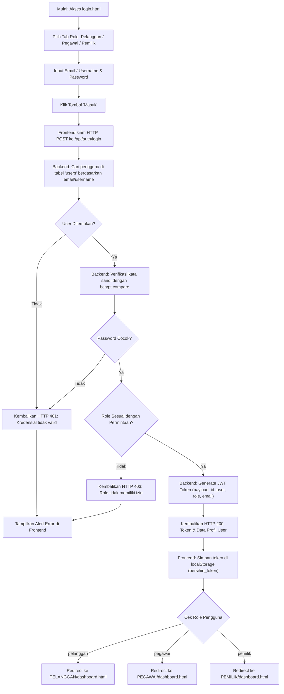
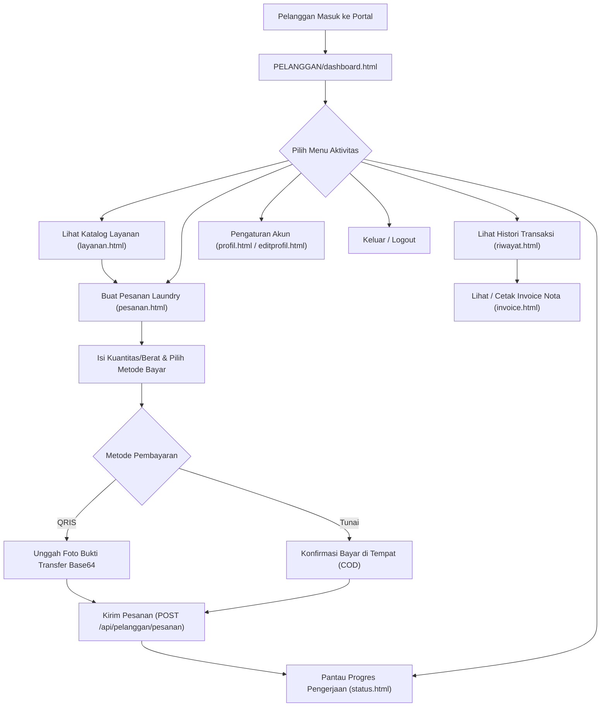
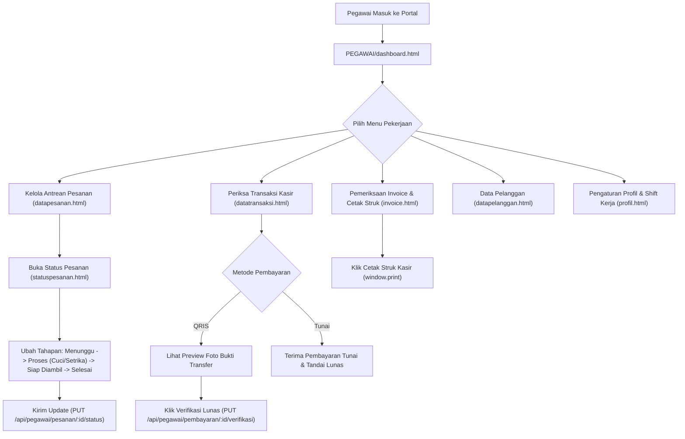
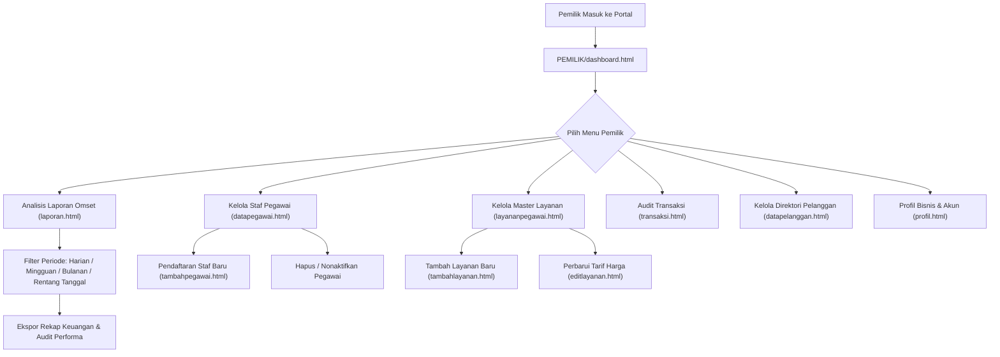
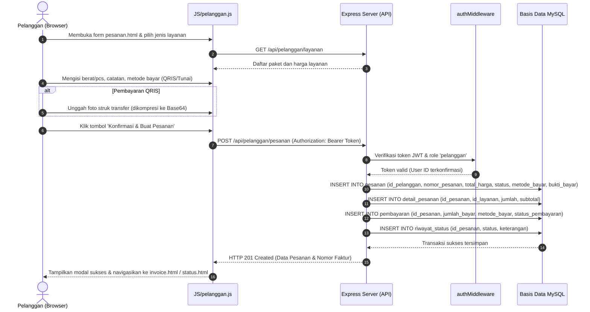
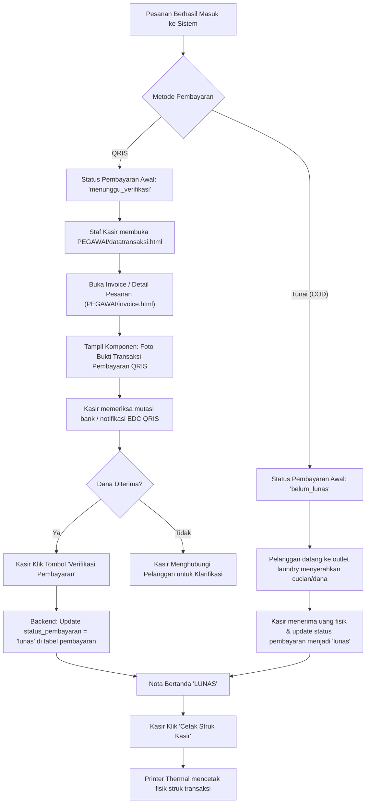
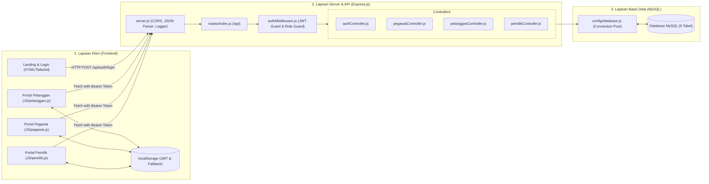

# DOKUMENTASI ALUR SISTEM (SYSTEM FLOW) - CLOUDLAUNDRY

Dokumen ini memvisualisasikan seluruh alur kerja, logika bisnis, dan interaksi data pada sistem **CloudLaundry / BersihIn Laundry** menggunakan diagram Mermaid standar yang didasarkan langsung pada kode sumber aktual.

---

## 1. Alur Login & Autentikasi Sistem (Unified Auth Flow)

Diagram berikut menggambarkan alur ketika pengguna mengakses `login.html`, memilih peran, hingga menerima token JWT dan diarahkan ke dasbor masing-masing:

---

## 2. Alur Aktivitas Pelanggan (Customer Journey)

Diagram berikut memetakan keseluruhan aktivitas yang dapat dilakukan oleh akun pelanggan:

---

## 3. Alur Aktivitas Staf Pegawai (Staff Operational Flow)

Diagram berikut menyajikan alur operasional kerja harian staf laundry dan kasir:

---

## 4. Alur Aktivitas Pemilik / Owner (Executive Management Flow)

Diagram berikut menyajikan pengawasan bisnis, audit keuangan, dan manajemen staf oleh pemilik:

---

## 5. Alur Pembuatan Pesanan Laundry (Order Placement Lifecycle)

Diagram alur transaksi pemesanan dari form input pelanggan hingga tersimpan di basis data:

---

## 6. Alur Transaksi, Verifikasi Pembayaran & Pencetakan Struk

Diagram berikut mengilustrasikan alur pemeriksaan bukti bayar dan settlement di kasir:

---

## 7. Arsitektur Komunikasi Frontend, Backend, dan Database

Diagram berikut memetakan relasi hierarki antara klien, middleware autentikasi, API controller, dan database server:

